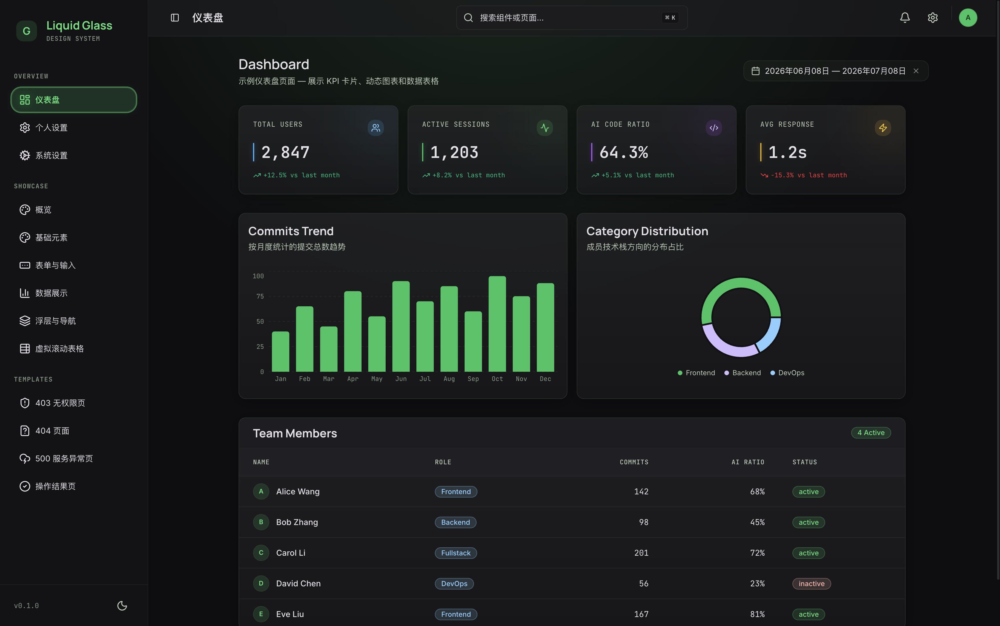

# Liquid Glass Starter

<!-- region:template-only -->

[](http://192.168.110.214:11070)

<!-- endregion:template-only -->

一个 **AI-Native 全栈启动脚手架与 Liquid Glass（毛玻璃拟态）设计系统**。基于 **Bun + Hono + Drizzle ORM + React 19 + Tailwind CSS v4** 构建，内置 Dark/Light 双模式与 **6 套运行时可切换主题色**（CSS 变量种子驱动，改主色无需改动组件代码），并配套完整的认证鉴权（RBAC）、操作审计、实时消息通知内核（SSE）与 AST 级代码架构门禁。



> 🎨 **核心规范与协同手册**：
>
> - **人机协同与需求开发流（必读）**：[AI 协同开发指南 (WORKFLOW.md)](./WORKFLOW.md)（人机职责边界、Spec 驱动 6 步工作流、版本演进与 2 分钟 Code Review 清单）
> - **视觉设计规范**：[设计系统规范 (DESIGN.md)](./DESIGN.md)（视觉 Token、色彩对比度、排版、响应式断点与玻璃拟态规范）
> - **AI 编码红线**：[AI 开发者指南 (AGENTS.md)](./AGENTS.md)（架构约束、目录契约与 AST 门禁）

---

<!-- region:template-only -->

## 🚀 Quick Start（AI-Native 脚手架创建）

本项目支持通过 **AI 技能 (`wecode-project-scaffolder`)** 交互式地在本地生成新项目。无论是全栈 TS Monorepo 还是异构后端（Go / Kotlin 平铺双目录），均支持一键初始化、数据库基线生成与 GitLab CI/CD 接入。

### 1. 安装 / 更新 AI 技能

通过 `npx giget` 免克隆整个仓库，直接将脚手架技能安装到对应 AI Agent 的全局目录（后续升级重新执行同一命令即可覆盖）：

#### macOS / Linux / Git Bash / WSL

```bash
# Qoder
npx giget git:git@192.168.110.2:starters/liquid-glass-starter/skills/wecode-project-scaffolder ~/.qoder/skills/wecode-project-scaffolder --force

# Qoder CN
npx giget git:git@192.168.110.2:starters/liquid-glass-starter/skills/wecode-project-scaffolder ~/.qoder-cn/skills/wecode-project-scaffolder --force

# Claude Code
npx giget git:git@192.168.110.2:starters/liquid-glass-starter/skills/wecode-project-scaffolder ~/.claude/skills/wecode-project-scaffolder --force

# Gemini / Antigravity
npx giget git:git@192.168.110.2:starters/liquid-glass-starter/skills/wecode-project-scaffolder ~/.gemini/config/plugins/wecode-plugin/skills/wecode-project-scaffolder --force
```

<details>
<summary>🪟 <strong>Windows (PowerShell / CMD) 安装命令</strong>（点击展开）</summary>

#### Windows (PowerShell)

```powershell
# Qoder
npx giget git:git@192.168.110.2:starters/liquid-glass-starter/skills/wecode-project-scaffolder "$HOME\.qoder\skills\wecode-project-scaffolder" --force

# Qoder CN
npx giget git:git@192.168.110.2:starters/liquid-glass-starter/skills/wecode-project-scaffolder "$HOME\.qoder-cn\skills\wecode-project-scaffolder" --force

# Claude Code
npx giget git:git@192.168.110.2:starters/liquid-glass-starter/skills/wecode-project-scaffolder "$HOME\.claude\skills\wecode-project-scaffolder" --force

# Gemini / Antigravity
npx giget git:git@192.168.110.2:starters/liquid-glass-starter/skills/wecode-project-scaffolder "$HOME\.gemini\config\plugins\wecode-plugin\skills\wecode-project-scaffolder" --force
```

#### Windows (CMD - 命令提示符)

```cmd
REM Qoder
npx giget git:git@192.168.110.2:starters/liquid-glass-starter/skills/wecode-project-scaffolder "%USERPROFILE%\.qoder\skills\wecode-project-scaffolder" --force

REM Qoder CN
npx giget git:git@192.168.110.2:starters/liquid-glass-starter/skills/wecode-project-scaffolder "%USERPROFILE%\.qoder-cn\skills\wecode-project-scaffolder" --force

REM Claude Code
npx giget git:git@192.168.110.2:starters/liquid-glass-starter/skills/wecode-project-scaffolder "%USERPROFILE%\.claude\skills\wecode-project-scaffolder" --force

REM Gemini / Antigravity
npx giget git:git@192.168.110.2:starters/liquid-glass-starter/skills/wecode-project-scaffolder "%USERPROFILE%\.gemini\config\plugins\wecode-plugin\skills\wecode-project-scaffolder" --force
```

</details>

### 2. 通过 AI 对话一键生成

在新目录开启 AI 助手对话，发送以下任一指令即可触发交互式向导：

- `用 Liquid Glass Starter 新建项目`
- `搭建脚手架` / `scaffold project`
- `给当前项目接入 GitLab CI`（存量项目追加 CI/CD）

### 3. 备用方案：通过本地 CLI 脚本创建

确保本地已安装 [Bun](https://bun.sh/) 后，可直接调用脚手架脚本：

```bash
bun run skills/wecode-project-scaffolder/scripts/scaffold.ts \
  --name "my-project-name" \
  --target "/absolute/path/to/my-project" \
  --type "monorepo" \      # 可选: monorepo | flat-go | flat-java (Kotlin)
  --db "drizzle" \         # 可选: drizzle (monorepo 默认) | gorm | jpa | none (仅 flat 支持)
  --clean-demo true \      # 可选: true (清理演示页，仅留工作台骨架) | false
  --clean-audit-log true \ # 可选: 清理审计日志前端页（monorepo 默认保留；flat 类型默认清理）
  --include-ci true        # 可选: true (生成 GitLab CI + Docker 部署配置并自动分配测试端口)
```

> 💡 **脚手架生成规则说明**：
>
> - 生成项目会自动剥离模板专属文件（`apps/api/init.sql`、`gen-init-sql.ts`、`compose.self.yml` 以及文档中的 `template-only` 区块），并基于 `schema.ts` 自动生成首份 Drizzle baseline 迁移；原 `README.md` 会归档为 `DESIGN_SYSTEM.md` 供随时查阅。
> - `--clean-demo true` 会移除组件展示页 / 演示数据，并同步裁剪 `menu-config.ts` 中的演示菜单入口（避免侧边栏死链）；**保留真实能力层**：monorepo 的登录页 + 认证守卫（JWT / 刷新 / 种子 admin）+ 顶栏通知中心组件与真实通知接口层；flat 模板无登录后端，才清理 LoginPage 并写入 bypass 守卫。
> - **审计日志页（B4）**：默认保留（monorepo 后端有 `audit_logs` 内核与 `/logs` API，`audit:view` 权限控制可见性）；传 `--clean-audit-log true` 可连同页面 / Diff 组件 / service+hook / 路由 / 菜单入口一起清理。`flat-go` / `flat-java` 模板后端没有 `/logs`，因此默认清理该前端页（避免生成项目出现 404 路由）。
> - `flat-go` / `flat-java` 模板仅生成 `/api/hello` 等最小后端骨架，不含内置通知/RBAC 后端模块。

---

<!-- endregion:template-only -->

## ⚖️ 技术选型原因与优劣分析 (Tech Stack & Trade-offs)

作为一个面向 **AI 结对编程（AI-Native）** 与 **高效工程交付** 的脚手架，我们在技术选型上坚持三个核心原则：**低黑盒/高透明（减少 AI 幻觉）**、**极速反馈闭环（秒级测试与编译）**、**编译期/AST 强约束（防止架构腐化）**。

### 1. 运行时与工具链：`Bun` (Workspaces + Runtime + Test + Compiler)

- **为什么选它**：传统 Node.js 全栈 Monorepo 需要拼装 `pnpm` + `tsx` + `vitest/jest` + `esbuild/pkg`，配置文件碎片化严重。Bun 将包管理器、TS 原生执行器、测试运行器（`bun:test`）、内置高性能 SQLite 驱动（`bun:sqlite`）以及单文件编译器（`bun build --compile`）五合一。
- **优势 (Pros)**：
  - **极速反馈闭环**：依赖安装、API 热重载与后端集成测试达到毫秒级，大幅缩短 AI Agent 编码后的验证等待时间。
  - **单文件二进制交付**：生产构建通过 `bun build --compile` 直接产出独立可执行文件 `/app/server`，生产容器无需拷贝庞大的 `node_modules`，镜像精简、冷启动极快。
- **劣势与边界 (Cons & Trade-offs)**：
  - 极少数重度依赖非标 Node.js C++ 原生扩展（Native Addons）的老旧 npm 包可能存在兼容问题。
  - `bun:sqlite` 与 Bun 运行时绑定；若未来强制迁移回纯 Node.js 运行时，需将驱动替换为 `better-sqlite3`。

### 2. 后端框架：`Hono` (Web Standards API)

- **为什么选它**：摒弃 Express 的陈旧回调模型与 NestJS 的重度装饰器/反射/IoC 容器黑盒，采用基于 Web 标准（`Request` / `Response`）的轻量框架 Hono。
- **优势 (Pros)**：
  - **对人类与 AI 极其透明**：采用直观的「薄路由（`.route.ts`）+ 显式服务层（`.service.ts`）」分层，调用链完全显式，AI 阅读、重构与写单测几乎零幻觉。
  - **原生契约与流式支持**：与 Zod 无缝集成，原生支持 SSE（Server-Sent Events）流式推送，无需引入庞大的 Socket.io。
  - **动静合一托管**：生产模式下直接由 Hono 托管前端编译产物（含 Gzip 压缩与 SPA 路由回退），单容器即可运行全栈应用，省去额外维护 Nginx 的开销。
- **劣势与边界 (Cons & Trade-offs)**：
  - 框架本身不像 NestJS 那样自带强制的 OOP 脚手架约束。为此，本项目通过 **自定义 ESLint AST 规则（`eslint-rules/`）** 在编译期补齐了架构强约束（如强制注入 `OpCtx` 审计上下文、禁止在路由层散落手写权限判断）。

### 3. 数据库与 ORM：`Drizzle ORM` + `bun:sqlite`

- **为什么选它**：相比 Prisma 需要维护独立的 `.prisma` DSL、每次改动需重新 `prisma generate` 且附带重型 Rust 引擎二进制，Drizzle 使用纯 TypeScript 定义表结构（[schema.ts](apps/api/src/db/schema.ts)），遵循“懂 SQL 就懂 Drizzle”。
- **优势 (Pros)**：
  - **零外部依赖开箱即用**：配合 `bun:sqlite`，开发者拉取代码无需先起 Docker MySQL/PostgreSQL 容器，即可本地完整运行鉴权、审计与游标分页。
  - **毫秒级真库单测**：API 测试直接使用 `:memory:` 内存 SQLite 执行完整建表与种子数据，测的是真实 SQL 逻辑而非脆弱的 ORM Mock。
  - **结构防漂移**：配套 `migrate:check` 预检脚本，在 CI 阶段自动拦截“改了 `schema.ts` 却忘生成迁移”的人为失误。
- **劣势与边界 (Cons & Trade-offs)**：
  - **SQLite 的单点与并发写边界**：开启 WAL 模式后足以支撑中小型业务、内部中后台与读多写少场景，但**不支持多副本水平扩展（Multi-Replica）或超高频并发写入**。当业务演进到分布式多实例时，需将 Drizzle Dialect 切换为 PostgreSQL / MySQL（业务层查询代码 95% 兼容），或在立项时选用本脚手架的 Go (GORM) / Kotlin (Spring Data JPA) 异构方案。

### 4. 前端视图与设计系统：`React 19` + `Vite` + `Tailwind CSS v4` + `shadcn/ui`

- **为什么选它**：放弃 Ant Design / MUI 等黑盒重型组件库（样式覆盖繁琐、包体积大、设计同质化），采用 Radix UI 无头无障碍原语（`shadcn/ui`）+ Tailwind CSS v4 + CSS 变量种子体系打造 **Liquid Glass** 视觉语言。
- **优势 (Pros)**：
  - **源码级白盒可控**：所有基础 UI 组件源码直接位于 `apps/web/src/components/ui/`，无黑盒样式穿透难题，AI 可直接阅读与按需改造。
  - **9 个种子变量驱动全局主题**：通过现代 CSS `color-mix()` 从种子色自动派生玻璃光晕、边框与图表色，实现 Dark/Light 双模式与 6 套主题色运行时零闪烁切换，同时将语义状态色（Success/Danger/Warning）与品牌色解耦，确保浅色态文字对比度 ≥ 4.5:1。
- **劣势与边界 (Cons & Trade-offs)**：
  - **现代浏览器基线要求**：强依赖 `color-mix()` 与 `backdrop-filter`（需 Chrome 111+ / Safari 16.2+ / Firefox 113+），不兼容老旧浏览器。
  - **大面积高斯模糊的 GPU 开销**：同屏过多叠加 `backdrop-filter: blur()` 会在低端核显设备上产生合成压力（设计规范中已通过限制模糊层级与静态降级策略进行规避）。

### 5. 前端状态分层：`TanStack Query v5` + `Zustand v5`

- **为什么选它**：严格划清**服务端缓存状态（Server State）**与**客户端纯 UI 状态（Client State）**的职责边界，告别传统 Redux 把异步接口数据手工同步到全局 Store 的样板代码泥潭。
- **优势 (Pros)**：
  - **服务端状态自动化**：列表缓存、过期重取、乐观更新（如通知一键已读）以及收到 SSE 推送后的精准缓存失效（`invalidateQueries`）全部由 TanStack Query 接管。
  - **客户端状态极简化**：Zustand 仅保留 `auth`（登录态）与 `layoutStore`（侧边栏折叠等），轻量且无 Context Provider 嵌套地狱。
- **劣势与边界 (Cons & Trade-offs)**：
  - 习惯传统写法的开发者或 AI 容易绕过 Query Hooks 直接在组件内调用 Service 或 Axios。本项目通过 ESLint 规则 `no-service-import-in-ui` 与 `arch:check` 从静态检查阶段直接阻断此类违规。

### 6. 全栈契约与 AI 护栏：`Zod` 共享包 + AST 架构门禁 (`eslint-rules/` & `arch:check`)

- **为什么选它**：AI 生成代码极快，但缺乏刚性护栏时，多次迭代后极易劣化出“硬编码 HEX/Tailwind 原色、UTC 时区截断导致日期少一天、写操作漏记审计日志”等隐患。
- **优势 (Pros)**：
  - **单一事实源 (`packages/shared`)**：前后端共享同一套 Zod 校验 Schema、枚举常量与权限注册表（`PERMISSION_REGISTRY`），一处修改全栈编译期联动检查。
  - **把架构规范编译成 AST 规则**：将团队约定沉淀为 `eslint-rules/` 下的自定义规则（自带原因说明与修复指引），让 AI 在编码阶段即可自我纠错。
- **劣势与边界 (Cons & Trade-offs)**：
  - 门禁较为严格，极少数合理例外需显式标注 `// eslint-disable-next-line <rule> -- <理由>`。
  - `packages/shared` 同构共享仅适用于 TS Monorepo；当切换为 Go / Kotlin 异构后端时，需切换为 OpenAPI 契约驱动（`openapi-typescript` / `Orval`）生成前端类型。

---

## 📂 项目结构与架构门禁

### 目录结构 (Monorepo)

本项目采用 `Bun Workspaces` 管理全栈多工作区：

```text
├── apps/
│   ├── web/                        # 前端应用 (React 19 + Vite + Tailwind v4)
│   │   ├── src/
│   │   │   ├── components/         # ui/ (shadcn 原语) · shared/ (高阶业务组件) · layout/
│   │   │   ├── hooks/queries/      # TanStack Query 服务端状态 Hooks
│   │   │   ├── lib/                # 工具库 (api, query-keys, theme-colors, date-utils 等)
│   │   │   ├── pages/              # 页面视图 (强制 React.lazy 懒加载，LoginPage 除外)
│   │   │   ├── services/           # 前端网络请求防腐层 (唯一允许调用 @/lib/api 的位置)
│   │   │   ├── stores/             # Zustand 客户端状态 (auth · layoutStore)
│   │   │   ├── theme-tokens.css    # 主题色种子与语义设计 Token
│   │   │   └── design-utils.css    # Liquid Glass 毛玻璃与排版工具类
│   │   └── vite.config.ts
│   └── api/                        # 后端服务 (Hono + Drizzle ORM + bun:sqlite)
│       ├── src/
│       │   ├── db/                 # schema.ts (唯一表结构源) · bootstrap.ts (惰性自举)
│       │   ├── middlewares/        # 认证 (JWT) · 权限 (requirePermission) · OpCtx 注入
│       │   ├── modules/            # 业务领域模块 (auth · user · notification · log，含 route + service)
│       │   ├── shared/             # 基础设施 (audited-crud · audit-log · notification · logger)
│       │   └── index.ts            # Hono 入口 (含健康检查、错误处理与生产静态文件托管)
│       └── drizzle.config.ts
├── packages/
│   └── shared/                     # 前后端共享包 (Zod Schemas · 权限码注册表 · 枚举与类型)
├── eslint-rules/                   # 自定义 AST 架构门禁规则与 RuleTester 单测
├── scripts/                        # 跨文件架构检查 (arch-check.ts) · 生产编译脚本 (build-server.sh)
├── DESIGN.md                       # Liquid Glass 视觉设计规范手册
├── AGENTS.md                       # AI Agent 协作与架构开发指南
└── package.json                    # Monorepo 根配置与统一命令入口
```

### 工程化与架构门禁（CI 阻断级）

项目将架构规范拆分为 **AST 单文件规则（ESLint）** 与 **跨文件不变量扫描（`arch:check`）**，在 Pre-commit（Husky + lint-staged）与 CI 阶段双重守护：

| 检查项 / 规则 ID                 | 守护目标与架构约束说明                                                                                                                           |
| -------------------------------- | ------------------------------------------------------------------------------------------------------------------------------------------------ |
| `no-tailwind-raw-colors`         | 禁止 UI 使用 `text-red-500` 等 Tailwind 原色类，以及 JSX 内联 `style` 的 `#hex`/`rgb()`/`hsl()` 硬编码颜色，强制语义化 Token 或 `color-mix(...)` |
| `no-service-import-in-ui`        | 禁止 `pages/` 与 `components/` 直接值导入 `@/services/*`，服务端数据必须经过 `hooks/queries/`                                                    |
| `no-toisostring-slice`           | 禁止 `.toISOString().slice/split` 截取日期（东八区会前移一天），强制使用 `@/lib/date-utils`                                                      |
| `no-raw-viewport-check`          | 禁止直读 `window.innerWidth`，响应式分支统一使用 `useIsMobile()` 或 Tailwind 断点类                                                              |
| `no-audit-fn-without-opctx`      | `*.service.ts` 中写审计日志的导出函数，首参必须显式声明 `OpCtx` 以确保操作人/IP/RequestId 完整                                                   |
| `no-restricted-syntax`           | 业务模块禁裸调 `writeLog(`；`*.route.ts` 默认禁止手写 `hasPermission(`（统一走中间件或领域层）                                                   |
| `no-restricted-imports`          | `*.route.ts` 禁止直连数据库（静态 import / re-export / 动态 `import()` 拦截 `db`、`drizzle-orm`、`bun:sqlite`）；web 端禁止 import 角色→权限映射 |
| `bun run arch:check`             | 跨文件扫描：强制所有路由页面在 `App.tsx` 中使用 `React.lazy` 分包；禁止 UI 层直连 `axios`/`sonner`；单文件 450 行棘轮门禁（含 api modules）      |
| `bun --filter api migrate:check` | 校验数据库 `schema.ts` 与迁移文件（或模板 `init.sql`）是否完全同步，防止漏提交迁移                                                               |

---

## 🛠️ 开箱即用与常用命令

### 快速启动

```bash
bun install
bun run dev
```

启动后前端运行在 `http://localhost:5173`（已配置 `/api` 代理转发至后端 `http://localhost:3000`）。

- **默认演示账号**：`admin`（或任意合法邮箱，Demo 模式下任意 6 位以上密码即可登录；`bun run db:reset` 会预置 `admin` / `demo` / `viewer` 三个账号与 7 条演示消息）。
- **全局快捷键**：
  - `D` 键：快速切换 Dark / Light 主题模式（输入框聚焦时自动忽略）。
  - `⌘K` / `Ctrl+K`：呼出全局 **Command Palette** 命令面板（与 [menu-config.ts](apps/web/src/lib/menu-config.ts) 导航索引实时联动）。

### 内置路由与演示页面

| 路由                                                     | 页面说明                                                             |
| -------------------------------------------------------- | -------------------------------------------------------------------- |
| `/login`                                                 | 毛玻璃登录页（动态光晕背景 + 表单校验 + 错误态 + Loading）           |
| `/dashboard`                                             | 仪表盘 Demo（KPI 卡片 + 柱状图 + 环形图 + 数据表格）                 |
| `/components`                                            | 组件总览（Utility Classes 速查展示）                                 |
| `/components/foundations`                                | 基础视觉规范（字体层级、间距、圆角、毛玻璃层级）                     |
| `/components/forms`                                      | 表单组件与复杂表单校验域                                             |
| `/components/data`                                       | 数据交互组件（响应式表格、移动端卡片、拖拽排序、分页、筛选栏）       |
| `/components/overlays`                                   | 浮层与导航组件（Tabs, ResponsiveDialog, Sheet, Alert, Toast）        |
| `/components/notifications`                              | 消息通知状态矩阵演示（Bell, NotificationPanel, 词表高亮）            |
| `/virtual-table`                                         | 10,000 行大数据虚拟滚动表格 Demo（`@tanstack/react-virtual`）        |
| `/settings`                                              | 个人设置页（含外观模式与 6 套主题色切换面板）                        |
| `/system-settings`                                       | 系统设置页（配置管理示例 + 危险操作 `DangerZone` 演示）              |
| `/audit-log`                                             | 审计日志查询页（服务端分页 + 多维筛选 + 变更 Diff，需 `audit:view`） |
| `/403-demo` · `/404-demo` · `/500-demo` · `/result-demo` | 异常状态页与操作结果反馈页 Demo                                      |

### 根目录脚本一览 (Root Commands)

| 命令                          | 说明                                                                          |
| ----------------------------- | ----------------------------------------------------------------------------- |
| `bun run dev`                 | 自动编译 `shared` 后并发启动 Web (5173) 与 Hono API (3000)                    |
| `bun run dev:web` / `dev:api` | 单独启动前端或后端开发服务器                                                  |
| `bun run build`               | 依次编译打包所有子模块（`shared` ➡️ `api` ➡️ `web`）                          |
| `bun run typecheck`           | 执行全局 TypeScript 类型检查                                                  |
| `bun run lint` / `lint:fix`   | 运行全仓 ESLint 检查（web + api + shared，含自定义 AST 规则）及自动修复       |
| `bun run lint:nocache`        | 无缓存 ESLint 验收（改自定义规则 / 配置后用，避免旧缓存复用旧结果）           |
| `bun run arch:check`          | 运行跨文件架构约束扫描                                                        |
| `bun run gen:module`          | 业务模块生成器：一键生成跨 shared/api/web 的模块骨架并自动注册                |
| `bun run test`                | 运行全部单元测试（`test:eslint` + `test:scripts` + `shared` + `web` + `api`） |
| `bun run test:eslint`         | 运行 `eslint-rules/` 自定义规则的 RuleTester 测试                             |
| `bun run test:scripts`        | 运行 `scripts/` 工具脚本单元测试（含 `gen:module` 生成器）                    |
| `bun run test:web`            | 运行前端 Vitest + happy-dom 单元测试                                          |
| `bun run test:api`            | 运行后端 `bun:test` 单元测试（基于 `:memory:` SQLite）                        |
| `bun run test:shared`         | 运行共享包单元测试                                                            |
| `bun run test:ci`             | CI 模式全量测试（含前后端测试覆盖率报告）                                     |

**数据库管理命令**：

| 命令                             | 说明                                                                    |
| -------------------------------- | ----------------------------------------------------------------------- |
| `bun --filter api db:generate`   | **生成项目**：修改 `schema.ts` 后生成 Drizzle 增量迁移 SQL              |
| `bun --filter api db:migrate`    | **生成项目**：手动将迁移应用到本地 SQLite（API 启动时也会惰性自动执行） |
| `bun run db:reset`               | 重置本地开发数据库并写入初始种子数据                                    |
| `bun run db:seed-dev`            | 向本地数据库补充开发环境演示数据                                        |
| `bun --filter api migrate:check` | 数据库结构一致性预检（校验 `schema.ts` 与迁移链/初始化脚本是否同步）    |

<!-- region:template-only -->

**模板仓库专属命令**（脚手架生成项目时会自动移除 `init.sql` 及以下脚本）：

| 命令                                | 说明                                                 |
| ----------------------------------- | ---------------------------------------------------- |
| `bun --filter api db:init:generate` | 从 `schema.ts` 重新生成单份 `apps/api/init.sql`      |
| `bun --filter api db:init:check`    | 校验 `apps/api/init.sql` 与 `schema.ts` 是否完全一致 |

> ⚠️ 模板仓库自身不维护迁移历史（直接调用 `db:generate` / `db:migrate` 会被守卫脚本拒绝），容器重建时直接由 `init.sql` 初始化空库。

<!-- endregion:template-only -->

---

## 🎨 主题色系统与样式工具类

### 运行时切换 6 套主题色

系统内置 6 套经过对比度调优的主题色，支持在 **顶栏 Palette 图标** 或 **个人设置 → 外观主题** 中实时切换。选择结果持久化在 `localStorage["theme-color"]` 并同步至 `<html data-theme-color="...">`，多标签页实时同步，切换明暗模式不会丢失主题色。

| 主题色         | `data-theme-color` | Dark `primary` / `bright` | Light `primary` / `bright` |
| -------------- | ------------------ | ------------------------- | -------------------------- |
| 翡翠绿（默认） | `green`            | `#22c55e` / `#4be277`     | `#006e2f` / `#22c55e`      |
| 科技蓝         | `blue`             | `#3b82f6` / `#60a5fa`     | `#1d4ed8` / `#3b82f6`      |
| 星云紫         | `purple`           | `#8b5cf6` / `#a78bfa`     | `#6d28d9` / `#8b5cf6`      |
| 极光青         | `cyan`             | `#06b6d4` / `#22d3ee`     | `#0e7490` / `#06b6d4`      |
| 落日橙         | `orange`           | `#f97316` / `#fb923c`     | `#c2410c` / `#f97316`      |
| 玫瑰粉         | `rose`             | `#ec4899` / `#f472b6`     | `#be185d` / `#ec4899`      |

#### 实现原理与对比度保障

- **种子派生机制**：[theme-tokens.css](apps/web/src/theme-tokens.css) 中的 `--theme-*-dark` / `--theme-*-light` 是主题色**种子**（共 11 个，其中 `primary-foreground-dark/light` 为全局常量，每个预设仅需覆盖其余 9 个）。`--primary`、`--lg-primary-*`、侧边栏高亮、光晕（glow）、图表主色（chart-1/2）均通过 `color-mix(in srgb, <seed> N%, transparent)` 自动派生。
- **语义色与品牌色解耦**：`success` / `danger` / `warning` / `info` 等语义状态色**不跟随主题色变化**（例如在蓝色或玫瑰粉主题下，“启用/成功”状态依然保持语义绿色 `--lg-success-*`）。
- **浅色态可读性**：主色与成功色文字使用独立 Token（`--lg-primary-text` 与 `--lg-success-text`），Dark 模式取亮色阶、Light 模式取深色阶，确保浅色背景下 12px 小字号依然满足 WCAG AA（≥ 4.5:1）对比度。
- **首屏防闪烁**：[index.html](apps/web/index.html) 内置前置内联脚本，在 React 挂载前即完成 `theme` 与 `theme-color` 属性注入。

#### 如何新增第 7 套主题色 / 修改默认主色

1. 在 [theme-colors.ts](apps/web/src/lib/theme-colors.ts) 的 `THEME_COLORS` 中注册新 `id` 与中文名（TS 类型自动推导）。
2. 在 [theme-tokens.css](apps/web/src/theme-tokens.css) 末尾新增 `:root[data-theme-color="<id>"]` 块，填入 9 个种子变量，并在 `:root` 补一条 `--theme-swatch-<id>`。
3. 运行 `bun run test:web`：单测会自动校验种子键完整性、swatch 一致性以及主色文字对比度（≥ 4.5）。
4. 若需**修改默认主色**，直接修改 `:root` 下的默认种子变量即可，切勿直接覆盖派生的 `--lg-primary-*`。

### 常用 Utility Classes 速查

| Class                                                   | 用途说明                                                    |
| ------------------------------------------------------- | ----------------------------------------------------------- |
| `.glass-card`                                           | 毛玻璃卡片（带阴影，放置紧密表格时常配合 `p-0 py-0 gap-0`） |
| `.liquid-card`                                          | 毛玻璃卡片（无外阴影，适合内嵌次级块）                      |
| `.liquid-glass`                                         | 通用毛玻璃容器                                              |
| `.glass-row`                                            | 表格行样式（Hover 时左侧浮现主题色发光指示条）              |
| `.kpi-accent` / `.liquid-accent`                        | KPI 卡片左侧发光竖条 / 普通强调竖条                         |
| `.btn-primary` / `.btn-secondary`                       | 主题色主按钮（高对比度文字） / 毛玻璃次要按钮               |
| `.glass-input`                                          | 毛玻璃输入框                                                |
| `.badge-active` / `.badge-inactive`                     | 启用（固定语义绿） / 停用状态徽章                           |
| `.tag-green` / `.tag-blue` / `.tag-purple` / `.tag-red` | 语义分类彩色标签                                            |
| `.skeleton-glass`                                       | 毛玻璃流光骨架屏                                            |
| `.section-title` / `.data-label`                        | 章节标题 / 等宽大写数据标签                                 |
| `.font-h1` / `.font-h2` / `.font-data-display`          | Manrope 标题字体层级 / JetBrains Mono 大号指标数字          |
| `.chart-container`                                      | Recharts 图表毛玻璃容器                                     |

---

## 🧩 核心组件与消息通知内核

### 1. KPI 指标卡 (`KpiCard`) 与日期范围选择器 (`DateRangePicker`)

```tsx
import { KpiCard } from "@/components/ui/kpi-card"
import { DateRangePicker } from "@/components/ui/date-range-picker"
import { DollarSign } from "lucide-react"

// KPI 卡片：accentColor="primary" 跟随当前主题色；green/blue/red/purple/yellow 为固定分类色
<KpiCard
  title="Monthly Revenue"
  value="$42.5K"
  icon={DollarSign}
  accentColor="primary"
  trend={{ value: "+12.5%", direction: "up", label: "vs last month" }}
/>

// 双月日历范围选择
<DateRangePicker dateRange={dateRange} onDateRangeChange={setDateRange} />
```

### 2. 消息通知前端组件 (`NotificationCenter`)

业务无关的純 UI 消息中心：`NotificationBell` 负责角标触发器，`NotificationPanel` 负责列表渲染與交互回调，`NotificationCenter` 组合 Popover。组件不直接发请求，业务类型图标、关键词高亮、点击跳转均通过 Props 注入：

```tsx
import { NotificationCenter } from "@/components/shared/NotificationCenter"
import { toNotificationItem } from "@/lib/notification-adapter"
import { CheckCircle2 } from "lucide-react"

// 1. 使用内置 adapter 将后端 wire 结构映射为 UI 视图模型
const notifications = page.items.map(toNotificationItem)

// 2. 渲染消息中心（顶栏 TopBar.tsx 已默认集成真实 API + 乐观更新 + SSE 实时刷新）
<NotificationCenter
  notifications={notifications}
  unreadCount={unreadCount}
  typeRegistry={{
    review_approved: { icon: CheckCircle2, tone: "success" },
  }}
  emphasis={[{ words: ["请及时审核", "待审核"], tone: "primary" }]}
  onMarkRead={(item) => markRead(item.id)}
  onMarkAllRead={markAllRead}
  onDelete={(item) => remove(item.id)}
  onItemClick={(item) => item.href && navigate(item.href)}
/>
```

- 正文中被 `「…」` 或 `『…』` 包裹的文本会自动渲染为实体胶囊（Chip）；如需完全接管正文渲染可传入 `renderContent`。

### 3. 消息通知后端内核（业务零样板接入）

后端已内置完整的「落库 + 游标分页 + 未读计数 + SSE 实时推送」通用内核。内核只管理 **收件人、不透明 `type`、标题/正文、业务扩展 `payload`、已读状态**，新增业务通知类型**无需修改数据库表或公共枚举**：

| 分层 | 核心文件                                                                                                                                                                                                                      | 职责说明                                                              |
| ---- | ----------------------------------------------------------------------------------------------------------------------------------------------------------------------------------------------------------------------------- | --------------------------------------------------------------------- |
| 契约 | [packages/shared/src/notification.ts](packages/shared/src/notification.ts)                                                                                                                                                    | 前后端共用的 Zod Schema、游标分页响应与 SSE 事件契约                  |
| 内核 | [apps/api/src/shared/notification.ts](apps/api/src/shared/notification.ts)                                                                                                                                                    | `notify / notifyMany / notifySafe`；保证「先落库、后推送」与幂等去重  |
| 总线 | [apps/api/src/shared/notification-bus.ts](apps/api/src/shared/notification-bus.ts)                                                                                                                                            | 进程内 EventEmitter（多实例部署时仅需将此文件替换为 Redis Pub/Sub）   |
| 路由 | [apps/api/src/modules/notification/](apps/api/src/modules/notification/)                                                                                                                                                      | 提供 `/notifications` 游标分页、`unread-count`、`read`、`stream` 等   |
| 前端 | [services/notifications.ts](apps/web/src/services/notifications.ts) · [useNotifications.ts](apps/web/src/hooks/queries/useNotifications.ts) · [useNotificationStream.ts](apps/web/src/hooks/queries/useNotificationStream.ts) | REST 服务封装 + `fetch` 流式 SSE 订阅（Bearer Header 鉴权，禁放 URL） |

业务模块发送通知只需一行调用：

```ts
import { notifyMany } from "../../shared/notification.js"

notifyMany(adminIds, {
  type: "review_submitted", // 任意业务字符串，前端通过 typeRegistry 映射图标与颜色
  title: "新的待审申请",
  content: `「${customerName}」已提交，请及时审核`,
  payload: { href: `/reviews/${reviewId}`, relatedCode: reviewCode },
  dedupeKey: `review_submitted:${reviewId}`, // 幂等键，防止重试产生重复通知
})
```

> 💡 **开发调试提示**：在 `NODE_ENV=development` 或 `DEMO_MODE=true` 下，后端额外开放 `POST /notifications/dev/push`（实时造数验证 SSE 冒角标）与 `POST /notifications/dev/reset`（一键恢复 7 条初始演示通知）。

### 4. 权限门控与导航自动派生 (`usePermission` + `PermissionGate`)

权限解析只在后端发生：登录与 `GET/PUT /users/me` 通过 `permissionsForRole(role)` 把角色映射为 `permissions: string[]` 下发（DB `role` 为 NULL 时按默认角色 `user` 处理，与 JWT 签发兜底同源）。starter 的注册表预置 `user:view` / `user:edit` / `audit:view`：`admin` 持有全量，`user` 角色仅持有 `user:*`，因此「审计日志」菜单与页面只对 admin 可见（见 Batch 4 的 `/audit-log`）。前端只消费这个数组，**不 import `ROLE_PERMISSIONS` 自行推导**——未来权限来源从静态映射切到 DB 动态授权时，消费侧零改动（早期登录的旧会话无该字段时按无权限处理，即 fail-closed）。`apps/web/src/**` 对该违规导入有 ESLint 门禁（`no-restricted-imports`）。

```tsx
import { PermissionGate } from "@/components/shared/PermissionGate"
import { usePermission } from "@/hooks/usePermission"
import { PERMISSIONS } from "shared"

// 声明式：无权限时不渲染（可传 fallback 显示兜底内容）
;<PermissionGate perm={PERMISSIONS.USER_EDIT}>
  <Button>编辑</Button>
</PermissionGate>

// 逻辑判断：can 单码 / canAny 任一命中
const { can, canAny } = usePermission()
if (canAny([PERMISSIONS.USER_VIEW, PERMISSIONS.USER_EDIT])) {
  /* ... */
}
```

- **菜单自动过滤**：`menu-config.ts` 的 `MenuItem.permission` 不填默认全员可见；填了由侧边栏与 ⌘K 用同一套 `can()` 过滤（`filterMenuGroups` / `filterMenuItems` 纯函数）。starter 的演示页当前全部公开（未标注 `permission`），属于 opt-in 空转；新增业务页标注后即生效。
- **面包屑自动派生**：`deriveBreadcrumbMap(menuGroups)` 按路径树生成「分组 / 页面」映射，`getBreadcrumbs(pathname)` 纯路径查询、与权限解耦；`getPageTitle` 也由它派生，导航标题只写一次。顶栏当前只渲染末级标题，分组面包屑供页面头部 / 详情页扩展。
- **当前实现边界（starter 简化）**：auth store 仅在登录成功时写入 `user` / `permissions`，访问个人设置页时 `GET /users/me` 的返回值不会回写 store；refreshToken 刷新只旋转 token、不重新查询角色（旧 accessToken 有效期内后端仍按旧 JWT role 鉴权）；权限随 `user` 持久化在 sessionStorage，旧会话缺字段时 fail-closed；RBAC 变更需用户主动登出再登录（无强制会话失效）。
- **边界**：导航/按钮隐藏只减少误操作，不等于鉴权；接口仍由后端 `requirePermission(...)` 与 `hasPermission` 把关。

### 5. 审计日志查询与变更 Diff (`AuditLogPage` + `AuditDiffViewer`)

`audit_logs` 表由服务端 `writeLog / auditedInsert|Update|Delete` 写入，配套提供**只读**查询闭环：

| 分层      | 核心文件                                                                                                                      | 职责                                                                                                                                          |
| --------- | ----------------------------------------------------------------------------------------------------------------------------- | --------------------------------------------------------------------------------------------------------------------------------------------- |
| 查询 API  | [modules/log/log.route.ts](apps/api/src/modules/log/log.route.ts) · [log.service.ts](apps/api/src/modules/log/log.service.ts) | `GET /logs`：多维筛选（模块 / 事件 / 结果 / 严重程度 / 关键字 / 时间范围）+ 偏移分页，`audit:view` 鉴权；**不提供客户端写入口**（防伪造审计） |
| 契约      | [packages/shared/src/audit.ts](packages/shared/src/audit.ts)                                                                  | `AuditLogSchema` / `AuditLogQuerySchema`（复用 Batch 1 分页契约）、严重程度与筛选选项、`MODULE_EVENT_TYPES` 级联映射                          |
| 页面      | [pages/audit-log/AuditLogPage.tsx](apps/web/src/pages/audit-log/AuditLogPage.tsx)                                             | TanStack Query 服务端分页 + FilterBar + 移动端卡片；无权限时不发请求                                                                          |
| 详情      | [AuditLogDetailDialog.tsx](apps/web/src/pages/audit-log/components/AuditLogDetailDialog.tsx)                                  | 基础信息 / 设备（UA 解析） / 变更明细三段式                                                                                                   |
| Diff 渲染 | [AuditDiffViewer.tsx](apps/web/src/components/shared/AuditDiffViewer.tsx)                                                     | 通用三态：标量对比 / 标签数组 / 键值对象；自动展开 snapshot 形（新增/删除）并反解析 JSON 字符串字段                                           |

> 说明：`lib/user-agent.ts` 是仓库既有工具，Batch 4 将其接入审计详情（按「谁消费、随谁交付」补齐消费端）。

### 6. 对象存储双模与 SQLite 运维工具箱 (`shared/oss` + `shared/sqlite-ops` + `DangerZone`)

面向团队常用后端基础设施的**零表依赖**工具箱：不建配置表、不挂演示路由，业务模块 import 即用，脚本 / 定时任务也可直接调用。

| 分层         | 核心文件                                                        | 职责                                                                                                                |
| ------------ | --------------------------------------------------------------- | ------------------------------------------------------------------------------------------------------------------- |
| 对象存储     | [shared/oss.ts](apps/api/src/shared/oss.ts)                     | 阿里云 OSS / 本地 mock 双模：自动判定、前缀派生、Post Policy 直传凭证、签名下载 URL、对象上传 / 分页列举 / 批量删除 |
| SQLite 运维  | [shared/sqlite-ops.ts](apps/api/src/shared/sqlite-ops.ts)       | `getSqliteStats()` / `runSqliteVacuum()` / `createSqliteBackup()`，`VACUUM INTO` 原子快照 + 本地 / 云端轮转         |
| 危险操作确认 | [DangerZone.tsx](apps/web/src/components/shared/DangerZone.tsx) | 危险操作分组卡 + 二次确认（可选密码验证 / 执行中 loading 锁），系统设置页已接入                                     |

**OSS 双模**：`OSS_ACCESS_KEY_ID` / `OSS_ACCESS_KEY_SECRET` / `OSS_BUCKET` **同时配置**才启用 OSS 模式，否则自动降级本地 mock（无需云账号即可开发上传下载链路）；生产环境半配置直接启动失败，避免静默降级成不可用链路。mock 模式的本地回退路由由业务方传入，工具不假设路由存在：

```ts
import {
  generateSignedUrl,
  getOssStoragePrefix,
  getUploadCredential,
} from "../shared/oss.js"

// 1) 对象 key 前缀由 OSS_PREFIX + 业务分类构成，避免硬编码目录
const key = `${getOssStoragePrefix("attachments")}${Date.now()}-${fileId}.pdf`

// 2) 上传凭证：OSS 模式返回 Post Policy 直传凭证，mock 模式返回本地回退路由
const credential = await getUploadCredential(key, {
  requestOrigin: "http://localhost:3000",
  mockRoutes: {
    uploadDirect: "/files/upload/direct",
    downloadPrefix: "/files",
  },
})

// 3) 下载：OSS 模式返回带 content-disposition 的签名 URL，mock 模式返回本地代理相对路径
const url = await generateSignedUrl(key, "合同.pdf", { expiresIn: 600 })
```

- 上传大小上限统一读 `UPLOAD_MAX_SIZE_MB`（默认 10 MB），同时写进 OSS Post Policy，客户端无法绕过；
- `listOssObjects` 自动翻页（单页 1000 个），`deleteOssObjects` 分批删除且单批失败只记日志、不中断整体清理；
- `OSS_ENDPOINT` 是 OSS 服务 endpoint（内网 / 代理场景）：直传 host 按 ali-oss 默认 `cname=false` 语义自动拼 `${bucket}.`（IP 形式 endpoint 除外），与 SDK 实际请求域名保持一致；下载侧 CDN 域名用 `OSS_CDN_DOMAIN`。注意 ali-oss 限制：纯 IP endpoint 不支持生成签名下载 URL（会提前抛可读错误），内网 IP 场景建议仅用于直传 / 服务端对象操作或改用域名；
- 直传凭证契约含 `host / policy / signature / OSSAccessKeyId / key / success_action_status`，前端**必须**把 `success_action_status`（`200`）与其他字段一起作为表单域提交，否则 OSS 会因 Policy 条件不满足拒绝上传；
- 环境变量见 [.env.example](.env.example)（`OSS_*` / `UPLOAD_MAX_SIZE_MB`）。

**SQLite 运维工具箱**（零表依赖、不写审计；是否审计、谁能触发由调用方 service 决定）：

```ts
import {
  createSqliteBackup,
  getSqliteStats,
  runSqliteVacuum,
} from "../shared/sqlite-ops.js"

const stats = getSqliteStats() // 库大小 / 空闲页 / WAL 大小 / 各表行数
const vacuum = runSqliteVacuum() // VACUUM + ANALYZE，返回回收量（排他锁，低峰期执行）
const backup = await createSqliteBackup({ retain: 30 }) // 快照落 DATA_DIR/backups；OSS 模式自动上传并轮转
```

- 快照用 `VACUUM INTO`（WAL 安全、原子），文件名内嵌时间戳，本地与 OSS 两条链路都按 key 字典序轮转；
- 三个函数都接受注入参数（`db` / `dir` / `storage`），单测无需真实云环境或落盘依赖；
- 未显式传 `db` 时默认参数会触发数据库惰性初始化（建库 / 迁移 / 播种）；`getSqliteStats` 的行数是 `COUNT(*)` 全表扫描，大库建议低峰期或用显式连接调用；
- 手动验证（在 `apps/api` 目录执行，会使用并初始化 `apps/api/data`，该目录已 gitignore）：

  ```bash
  cd apps/api
  bun -e 'import { createSqliteBackup } from "./src/shared/sqlite-ops.ts"; console.log(await createSqliteBackup())'
  ```

**DangerZone**：系统设置页的「危险操作」区已接入，分组卡统一承载清理 / 重置类操作：

```tsx
<DangerZoneGroup
  items={[
    {
      title: "清理过期日志",
      description: "仅清理超过保留期的审计日志",
      badgeText: "可清理 0 条",
      buttonText: "执行清理",
      requirePassword: true,
      onConfirm: handleCleanup,
    },
  ]}
/>
```

- `requirePassword: true` 时密码会作为 `onConfirm(password)` 首参透传，业务方必须在后端完成真实身份校验——组件只做「非空 + 二次确认」的 UI 门禁，**UI 门禁 ≠ 鉴权**；
- `onConfirm` 抛错/拒绝时组件结束 loading **并保留弹窗**（密码模式会清空密码）便于重试，错误提示由调用方负责；成功才关闭弹窗。

> 说明：`DangerZone` 是仓库既有组件，Batch 5 补齐单元测试与文档，并让 `requirePassword` 把密码透传给 `onConfirm` 供服务端校验（视觉与交互实现未改）。

---

## 🧱 业务模块生成器（`gen:module`）

把「共享契约 → 后端 service/route/测试 → 前端 service/hooks/页面/表单 → 权限/审计/路由/菜单注册」这条标准流水线收敛成一条命令（仅 monorepo 形态可用，平铺模板不含本生成器）。

```bash
# 模式 A（默认）：标准服务端分页 CRUD 模块
bun run gen:module --name contract --label "合同" --icon FileText

# 模式 B：轻量字典/分类模块（DataTable 全量拖拽重排 sortOrder）
bun run gen:module --name category --label "分类" --icon Tag --mode sortable
```

### 选项

| 选项                      | 说明                                                                                                                                                         |
| ------------------------- | ------------------------------------------------------------------------------------------------------------------------------------------------------------ |
| `--name <kebab>`          | 必填。kebab-case 模块名（小写字母 / 数字 / 连字符），决定文件名、标识符、表名与权限码                                                                        |
| `--label <中文>`          | 必填。中文模块名（≤30 字符），进入菜单 / 审计标签 / 页面标题；拒绝引号 / 反引号 / 反斜杠 / 尖括号 / 花括号 / 换行（会破坏生成的 TS/JSX），中文标点与数字可用 |
| `--icon <Lucide>`         | 菜单图标组件名（默认 `FileText`）；生成前校验是否为 lucide-react 真实导出                                                                                    |
| `--mode <crud\|sortable>` | 默认 `crud`；`sortable` = 字典类全量列表 + 拖拽重排 `sortOrder`                                                                                              |
| `--force`                 | 覆盖已存在的生成文件；要求 mode/label/icon 与已生成模块一致（见下）                                                                                          |
| `--dry-run`               | 只打印将创建 / 修改的文件，不落盘（同样校验参数与锚点）                                                                                                      |
| `--skip-format`           | 跳过 prettier + eslint --fix（默认自动格式化）                                                                                                               |
| `--skip-db`               | 跳过数据库结构同步（默认自动写 init.sql / drizzle 迁移）                                                                                                     |
| `-h, --help`              | 打印帮助                                                                                                                                                     |

### 生成内容

| 文件                                                          | 说明                                                               |
| ------------------------------------------------------------- | ------------------------------------------------------------------ |
| `packages/shared/src/<name>.ts`                               | wire 契约（Zod schema + 类型）、表单契约、列表查询/重排契约        |
| `apps/api/src/modules/<name>/<name>.service.ts`               | 业务不变量（409/404）+ 声明式审计（`auditedInsert/Update/Delete`） |
| `apps/api/src/modules/<name>/<name>.route.ts`                 | 薄 handler：鉴权 → 参数校验 → service → `mapServiceError`          |
| `apps/api/src/modules/<name>/<name>.route.test.ts`            | 接口集成测试（列表/创建/冲突/校验/更新/删除/401/403/审计断言）     |
| `apps/web/src/services/<name>.ts`                             | API 调用封装（唯一允许触碰 axios 实例的层）                        |
| `apps/web/src/hooks/queries/use<Pascal>.ts`                   | TanStack Query hooks（列表 + 写操作失效 + 乐观重排，若 sortable）  |
| `apps/web/src/pages/<name>/<Pascal>Page.tsx`                  | 列表页（FilterBar + DataTable + MobileCard + 权限门控）            |
| `apps/web/src/pages/<name>/components/<Pascal>FormDialog.tsx` | 新增/编辑弹窗（ResponsiveDialog + 服务端字段错误回填）             |
| `apps/web/src/pages/<name>/hooks/use<Pascal>Form.ts`          | react-hook-form + zodResolver 表单 hook（复用 shared 契约）        |

同时自动完成 8 处注册：`permissions.ts`（权限码 + 注册表）、`audit.ts`（审计模块 + 中文标签 + 事件映射）、`shared/index.ts`（导出，文件末尾追加）、`db/schema.ts`（表，文件末尾追加）、`api/src/index.ts`（route import + 挂载）、`query-keys.ts`（query key 工厂）、`App.tsx`（`React.lazy` + 路由）、`menu-config.ts`（`Business` 分组菜单项，首次生成时创建）。

其中 6 处插入型注册依赖源码里的 `[gen:module:*]` 注释锚点定位；`shared/index.ts` 与 `db/schema.ts` 是文件末尾追加段落（无锚点）。

### 生成后

```bash
bun run db:reset  # 本地库已存在时：重建以应用新表（会清空本地数据）
bun run typecheck && bun run lint:nocache && bun run arch:check && bun run test
```

- 生成器会自动跑 `prettier` + `eslint --fix`，并按仓库形态同步数据库结构来源（模板仓库 `init.sql` / 生成项目 drizzle 迁移）；写盘后格式化或数据库同步失败时**自动回滚**本次文件改动；
- 生成代码里的「编码 / 名称 / 状态 / 描述」是占位字段，可参照 [WORKFLOW.md](./WORKFLOW.md) 配合 [`.agents/skills/business-feature-builder/SKILL.md`](.agents/skills/business-feature-builder/SKILL.md) 技能与 [`docs/specs/_template.md`](docs/specs/_template.md) 5 要素规格书模板（实体字段 / 业务不变量 / 权限 / 审计 / 界面布局）替换后重跑数据库同步命令；
- 权限默认只注册到注册表（admin 自动持有全量），普通角色需在 `ROLE_PERMISSIONS` 显式授予（fail-closed）；
- 重复执行幂等：已注册的权限 / 审计 / 路由 / 菜单 / query key 会跳过；目标文件已存在时需显式 `--force`；
- `--force` **只覆盖 9 个生成文件，不会重写已登记的权限 / 审计 / 菜单 / 表结构**：若 mode / label / icon 与已生成模块不一致会直接报错，避免 registry 与代码不一致。需要换参数时先删除生成文件并用 git 还原注册文件，再重新生成；
- 生成器自身有单测（`bun run test:scripts`）与 typecheck（`bun run typecheck:scripts` / `bun run lint:scripts`）。

> 生成器依赖源码里的 `[gen:module:*]` 注释锚点定位注册位置（如 `// [gen:module:permissions]`）。请勿删除 / 改写这些锚点，否则 `gen:module` 会直接报错而不是猜测位置；`bun run test:scripts` 会校验真实注册文件里的锚点存在且唯一。

---

## 🗄️ 数据库开发流与异构后端扩展

### 默认数据库层（Drizzle ORM + SQLite）

- **唯一事实源**：[apps/api/src/db/schema.ts](apps/api/src/db/schema.ts)
- **惰性自举**：[apps/api/src/db.ts](apps/api/src/db.ts) 在首次收到数据库请求时自动触发 [bootstrap.ts](apps/api/src/db/bootstrap.ts) 完成迁移或初始化，模块加载阶段不产生文件 I/O 副作用。
- **开发流**：修改 `schema.ts` ➡️ 执行 `bun --filter api db:generate` 生成迁移并提交 Git ➡️ 重启服务自动应用迁移（或执行 `bun run db:reset` 重建本地库）。

<!-- region:template-only -->

### 模板自部署 vs 脚手架生成项目差异

| 维度       | 模板仓库自身 (`liquid-glass-starter`)              | 脚手架生成的新项目 (`scaffold`)     |
| ---------- | -------------------------------------------------- | ----------------------------------- |
| 部署编排   | `compose.self.yml`（不会复制到新项目）             | `compose.test.yml` / `compose.yml`  |
| 数据持久化 | `/app/data` 挂载 `tmpfs` 内存盘，容器重启即空库    | `./data` 宿主机持久卷               |
| 结构初始化 | 空库直接执行单份 `apps/api/init.sql`               | 标准 `apps/api/drizzle/` 增量迁移链 |
| 演示模式   | 默认开启 `DEMO_MODE=true`（自动幂等补齐 7 条通知） | 默认关闭，完全由真实业务数据驱动    |

<!-- endregion:template-only -->

### 切换为 Go / Kotlin 异构后端（平铺双目录架构）

若业务后端选用 **Go (GORM)** 或 **Kotlin (Spring Boot + JPA)**，强烈建议使用脚手架的 `--type flat-go` 或 `--type flat-java` 生成**前后端独立平铺结构**，避免根目录 JS Workspaces 对 GoLand / IntelliJ IDEA 造成干扰：

```text
my-project/
├── frontend/             # 前端项目 (原 apps/web，独立管理 package.json 与依赖)
├── backend/              # 后端项目 (直接放置 go.mod 或 build.gradle.kts)
├── Taskfile.yml          # 跨语言任务编排 (运行 task dev 一键并发启动前后端)
└── DESIGN_SYSTEM.md      # 归档的设计系统与组件参考手册
```

**异构架构下的契约与防腐规范**：

1. **代理配置**：前端 `frontend/vite.config.ts` 中将 `/api` 代理目标指向后端端口（如 `http://localhost:8080`）。
2. **OpenAPI 类型生成**：后端通过 `swaggo`（Go）或 `springdoc-openapi`（Kotlin）导出 Swagger 规范，前端使用 `openapi-typescript` 或 `Orval` 自动生成 TS 类型定义：
   ```bash
   npx openapi-typescript http://localhost:8080/v3/api-docs -o src/types/api.d.ts
   ```
3. **严守 Service 防腐层**：所有网络调用必须封装在 `frontend/src/services/` 内，并通过 `hooks/queries/` 暴露给组件，严禁将后端 SDK 直接泄漏到 UI 页面中。

---

## 🚢 生产环境部署方案

### 方案一：单容器全栈一体部署（推荐 · 零 Nginx 开销）

本项目已完成生产环境「动静合一」开箱配置：

1. **构建阶段（[scripts/build-server.sh](scripts/build-server.sh)）**：依次编译 `packages/shared`、使用 `bun build --compile` 将 Hono 后端打包为单文件可执行二进制 `dist/server`、并使用 Vite 构建前端静态产物 `apps/web/dist`。
2. **运行阶段（[apps/api/src/index.ts](apps/api/src/index.ts) & [Dockerfile](Dockerfile)）**：当环境变量 `NODE_ENV=production`（或 `SERVE_STATIC=true`）时，Hono 自动将 API 路由挂载到 `/api/*`，同时通过 `hono/bun` 的 `serveStatic` + `compress()` 直接托管 `./web` 静态资源并处理 SPA 路由回退，且将 `idleTimeout` 设为 120s 以保障 SSE 长连接稳定。

```bash
# 使用 Docker Compose 一键构建并启动全栈容器
docker compose -f compose.yml up -d --build
```

### 方案二：前后端分离部署（高并发 / CDN 边缘分发）

- **前端（Vite SPA）**：执行 `bun run build:web`，将 `apps/web/dist` 上传至对象存储 + CDN、Nginx 或 Vercel / Cloudflare Pages。
- **后端（Hono API）**：执行 `sh scripts/build-server.sh`（或使用 Docker 镜像），单独运行后端二进制进程，并在环境变量中配置 `FRONTEND_URL` 以启用精确的 CORS 跨域白名单。

---

<details>
<summary>📎 <strong>附录：仅将 Liquid Glass UI 主题手工移植到存量 React 项目</strong>（点击展开）</summary>

如果您不需要本脚手架的全栈工程结构，只想把 Liquid Glass 的视觉样式与基础组件迁移到已有的 Vite + React 项目中，可按以下 3 步提取：

1. **安装 Tailwind CSS v4 与基础依赖**：
   ```bash
   npm install tailwindcss @tailwindcss/vite tw-animate-css
   npm install clsx tailwind-merge lucide-react class-variance-authority radix-ui
   ```
2. **复制核心样式与组件目录**：
   ```bash
   cp apps/web/src/index.css apps/web/src/theme-tokens.css apps/web/src/design-utils.css your-project/src/
   cp -r apps/web/src/components/ui apps/web/src/components/theme-provider.tsx your-project/src/components/
   cp -r apps/web/src/lib/utils.ts apps/web/src/lib/theme-colors.ts your-project/src/lib/
   cp -r apps/web/src/assets/fonts your-project/src/assets/
   ```
3. **包裹 `ThemeProvider`**：在入口组件中使用 `<ThemeProvider defaultTheme="dark">` 包裹应用，并参考 `apps/web/index.html` 注入首屏防闪烁脚本即可。

</details>
