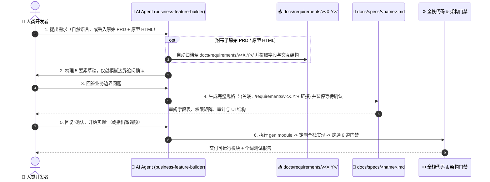

# AI 协同开发指南 (Human-AI Workflow)

本项目采用 **Spec 驱动 + 脚手架确定性生成 + AST 架构门禁兜底** 的 AI-Native 研发模式。通过将 [business-feature-builder](.agents/skills/business-feature-builder/SKILL.md) 技能、5 要素规格书（`docs/specs/<name>.md`）与全栈代码生成器（`bun run gen:module`）串联，让人类开发者专注于**业务意图与规则决策**，由 AI 完成从原始资料归档、规格书编写、全栈落码到门禁验收的闭环。

---

## 1. 仓库核心文档分工

| 文档路径                                                     | 目标读者                   | 核心职责                                                                              |
| :----------------------------------------------------------- | :------------------------- | :------------------------------------------------------------------------------------ |
| [README.md](./README.md)                                     | 人类开发者                 | 项目架构总览、快速启动、内置能力与部署手册                                            |
| **[WORKFLOW.md](./WORKFLOW.md)（本文档）**                   | **人类开发者 / Tech Lead** | **拿到业务需求后如何与 AI 配合、人机边界、原始资料归档、Spec 版本管理与 Review 清单** |
| [DESIGN.md](./DESIGN.md)                                     | 人类 + AI（按需读取）      | Liquid Glass 视觉 Token、毛玻璃层级、色彩与响应式布局规范                             |
| [AGENTS.md](./AGENTS.md)                                     | AI Agent（每轮自动注入）   | 编码红线、目录契约与强制架构门禁（保持高密度以节约上下文 Token）                      |
| [SKILL.md](.agents/skills/business-feature-builder/SKILL.md) | AI Agent（触发技能时加载） | 新建/迭代业务模块的 6 阶段 SOP 指令、原始资料归档规则与防坑清单                       |
| [docs/specs/\_template.md](docs/specs/_template.md)          | AI 生成 / 人类审阅         | 5 要素业务规格书空白模板（由 AI 自动复制并填充，人无需手填）                          |

---

## 2. 人机职责边界 (Human vs. AI Boundary)

在开发或迭代任何业务模块时，**人与 AI 的边界遵循“人给业务输入与决策、AI 管归档与代码”原则**：

| 阶段              | 👤 人类开发者（Product / Dev）负责什么？                                                                       | 🤖 AI Agent（`business-feature-builder`）负责什么？                                                                                                                  |
| :---------------- | :------------------------------------------------------------------------------------------------------------- | :------------------------------------------------------------------------------------------------------------------------------------------------------------------- |
| **0. 需求输入**   | 用自然语言描述需求，或直接把**产品给的原始 PRD / 原型 HTML 文件**丢给 AI（支持本地路径、拖入工作区或粘贴正文） | **自动归档原始资料**至 `docs/requirements/v<X.Y>/`；自动解析 PRD 与原型 HTML 提取字段/筛选/列表/弹窗结构（**丢弃 HTML 硬编码样式，映射为 Liquid Glass 组件**）       |
| **1. 边界对齐**   | **回答 AI 提出的几个关键业务决策问题**（若已提供原型 HTML，页面字段无需再答，仅确认隐性权限与拦截规则）        | 基于现有基建（`PERMISSION_REGISTRY`、`auditedCrud`、`DataTable`）仅针对 PRD/HTML 未明确的服务端边界提出选择题，**未对齐前绝不擅自写代码**                            |
| **2. 规格书定稿** | **审阅 `docs/specs/<name>.md` 表格**，确认字段、权限与状态流转无误后回复“确认”                                 | 自动读取 `docs/specs/_template.md` 生成/更新 `docs/specs/<name>.md`（在 `0.2 版本演进记录` 中挂好指向 `../requirements/v<X.Y>/` 的可点击链接），**暂停等待人类拍板** |
| **3. 骨架生成**   | _无需介入_                                                                                                     | 自动拼装参数执行 `bun run gen:module` 落盘 9 个模块文件 + 8 处跨层锚点注册                                                                                           |
| **4. 业务定制**   | _无需介入_                                                                                                     | 按定稿 Spec 替换占位字段，补齐 Drizzle Schema、Zod 契约、`ServiceError` 业务守卫、声明式审计 diff、Liquid Glass 表单与双端测试                                       |
| **5. 门禁与验收** | **体验页面交互 + 2 分钟重点 Code Review**（见第 5 节清单），确认后合入分支                                     | 依次跑通数据库迁移同步、`typecheck`、`lint:nocache`、`arch:check`、`test:api`、`test:web`，修复所有报错并勾选 Spec 验收项                                            |

### 核心原则：4 做 4 不做

- **人只需做 4 件事**：① 丢原始需求（一句话或 PRD/HTML 文件） → ② 答几个边界选择题 → ③ 审阅一页 Markdown 表格点“确认” → ④ 最终看一眼页面与核心业务规则。
- **人绝不需要做的 4 件事**：① **不需要**手动去 `docs/requirements/` 建目录整理文件 → ② **不需要**手动复制 `_template.md` 填表格 → ③ **不需要**手敲 `bun run gen:module` 命令 → ④ **不需要**手动维护 Spec 版本号与历史链接。

---

## 3. 新功能开发 6 步标准流程



### 对话启动话术示例（直接复制使用）

> **示例 1：有产品原始 PRD 与原型 HTML（AI 自动归档 + 提取字段）**
> 「这是产品给的一期需求文档 `~/Downloads/一期需求.md` 和合同页面原型 `~/Downloads/contract.html`，请按 `v1.0` 帮我归档并开发**合同管理（contract）**模块，先提炼规格书给我确认。」

> **示例 2：纯自然语言描述的 CRUD 模块**
> 「我们要加一个**合同管理（contract）**模块：记录合同编号、标题、客户名称、合同金额（分）、签署日期和状态（草稿 / 生效中 / 已归档）。普通用户只能查看和创建草稿，管理员可以审批生效和删除；状态变更为生效时给创建人发站内通知。请先帮我对齐需求并生成规格书。」

> **示例 3：字典 / 拖拽排序模块（`sortable` 模式）**
> 「帮我做一个**渠道字典（channel）**管理页面，支持拖拽排序和启用/停用切换，包含渠道编码、渠道名称、负责人和备注字段，仅管理员可增删改排。」

---

## 4. 原始资料归档与规格书（Spec）版本管理

项目采用 **“上游原始资料按迭代版本聚合（`docs/requirements/v<X.Y>/`）+ 中游工程规格书按业务模块平铺（`docs/specs/<name>.md`）”** 的双层结构：

- **为什么 `requirements/` 版本号在前？** 产品提需求是按迭代版本（如 `v1.0` 一期、`v1.1` 二期）交付的，一份综合 `prd.md` 往往同时包含多个功能模块；且日常口头小改动没有外部附件，不应产生碎片目录。
- **为什么 `specs/` 按模块名平铺？** 代码与 `gen:module --name <name>` 按模块组织，顶层 `docs/specs/<name>.md` 永远代表该模块当前的 100% 最新全量契约，AI 按模块名一步定位，无需跨目录拼凑增量。

### 目录结构

```text
docs/
├── requirements/                      # 📥【上游：产品原始交付物】按“迭代版本”聚合（AI 自动归档，只读封存）
│   ├── v1.0/                          # v1.0 一期需求包（可包含跨模块总 PRD + 多张模块原型 HTML）
│   │   ├── prd.md                     # 一期综合 PRD（或 contract-prd.md）
│   │   ├── contract.html              # 合同模块静态原型 HTML
│   │   ├── channel.html               # 渠道模块静态原型 HTML
│   │   └── assets/                    # 本期配套流程图、截图
│   └── v1.1/                          # v1.1 二期需求包（仅当有新 PRD/HTML 原件交付时才由 AI 创建）
│       ├── prd.md                     # 二期变更 PRD
│       └── contract-audit.html        # 二期新增审批弹窗原型
│
└── specs/                             # 📐【中游：AI 工程规格书】按“业务模块”平铺（与代码 1:1 映射）
    ├── _template.md                   # 5 要素规格书空白模板
    ├── contract.md                    # 合同模块当前全量规格（演进表链接到 ../requirements/v1.x/）
    ├── channel.md                     # 渠道模块当前全量规格（演进表链接到 ../requirements/v1.x/）
    └── archive/                       # 仅跨大版本（v1 -> v2）推翻重构时归档旧版 Spec
        └── v1/
            └── contract.md            # 归档的 contract v1.x 最终态快照
```

### AI 解析原型 HTML 的「取其神、弃其皮」法则

产品或设计给的 `.html` 原型通常由蓝湖 / Axure / Claude Artifacts / v0 导出，内部含有大量硬编码色值（`bg-blue-500`、`#ffffff`）或原生 `<table>`。AI 读取 `.html` 时强制执行：

- **取其神（自动提取信息架构）**：自动提取筛选栏条件、列表展示列、状态 Tab、操作按钮与弹窗表单字段填入 Spec，不再重复追问人类；
- **弃其皮（严禁照搬硬编码样式）**：**绝不直接复制 HTML 里的样式与标签**，全部自动重构为本项目的 Liquid Glass 共享组件（`DataTable`、`FilterBar`、`ResponsiveDialog`、`StatusBadge`）与 `--lg-*` 语义主题变量。

### 版本映射桥梁：`0.2 版本演进记录`

每个模块的 `docs/specs/<name>.md` 通过 **`0.2 版本演进记录`** 表格将“模块 Spec 版本”与“上游原始资料”双向绑定：

| 版本号   | 日期         | 变更类型 | 原始资料归档 (PRD / 原型)                                                                                   | 需求摘要与关键影响点                                                 |
| :------- | :----------- | :------- | :---------------------------------------------------------------------------------------------------------- | :------------------------------------------------------------------- |
| `v1.0`   | `2026-11-05` | 初始创建 | `[prd.md](../requirements/v1.0/prd.md)` · `[contract.html](../requirements/v1.0/contract.html)`             | 一期上线：完成合同基础 CRUD、审批生效与通知                          |
| `v1.1`   | `2026-11-12` | 版本迭代 | `[prd.md](../requirements/v1.1/prd.md)` · `[contract-audit.html](../requirements/v1.1/contract-audit.html)` | 二期迭代：新增客户电话必填；已归档合同禁止编辑与删除                 |
| `v1.1.1` | `2026-11-15` | 对话微调 | `对话直接指令（无外部附件）`                                                                                | 小改动：列表默认排序改为按签署日期倒序（**不建 requirements 目录**） |

### 三种变更场景怎么配合？

1. **带新 PRD / 原型 HTML 的版本迭代（`v1.0` → `v1.1`）**：
   - 把新文档/HTML 丢给 AI → AI 自动归档至 `docs/requirements/v1.1/` → 原地更新 `docs/specs/<name>.md` 第 1~5 节全量表并在 `0.2 版本演进记录` 追加 `v1.1` 链接 → 经你确认后增量修改代码。
2. **日常口头小功能 / 小改动（`v1.1` → `v1.1.1`，无外部文件）**：
   - 直接在对话框说改动点 → AI **不在 `docs/requirements/` 下建任何目录**，直接更新 `docs/specs/<name>.md` 并记录 `对话直接指令` → 增量改代码跑门禁。
3. **跨大版本推翻重构（`v1.x` → `v2.0`）**：
   - AI 先将旧版 `docs/specs/<name>.md` 移入 `docs/specs/archive/v1/<name>.md` 封存，再在顶层生成全新的 `v2.0` 规格书。

---

## 5. 人类的 2 分钟极简 Code Review 清单

AI 完成开发汇报时，以下 **工程规范已由自动化门禁 100% 强制把关**，人类无需再肉眼逐行检查：

- ✅ 前后端 TypeScript 类型对齐与无未使用变量（`bun run typecheck`）
- ✅ 禁用硬编码颜色、禁止 UI 直连 Service/API、禁止 Route 直连 DB、审计函数强制 `OpCtx` 首参（`bun run lint:nocache`）
- ✅ 页面 `React.lazy` 懒加载与单文件 ≤ 450 行棘轮上限（`bun run arch:check`）
- ✅ 前后端单元测试与真实数据库/路由契约验证（`bun run test`）

**人类 Reviewer 只需花 2 分钟重点检查以下 3 个位置**：

1. **[`docs/specs/<name>.md`](docs/specs/_template.md)**：第 1~5 节表格是否与你的真实业务意图一致？
2. **`packages/shared/src/<name>.ts`**：Zod 校验边界（最小/最大值、必填/可空、英文枚举值常量与中文 `*_LABELS`）是否符合业务常识？
3. **`apps/api/src/modules/<name>/<name>.service.ts`**：领域级业务守卫（如“什么状态下抛 `ServiceError(409/403)` 拒绝修改或删除”、“审计日志 `trackedFields` 是否排除了敏感字段”）是否严密？
